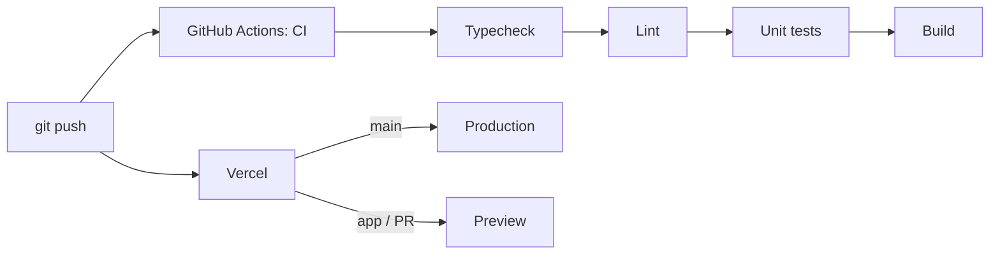

# BLOOMS

[](https://github.com/davidmualem1997/blooms/actions/workflows/ci.yml)

מערכת לניהול סושיאל מדיה לסטודיו: גאנט תוכן, תכנון פיד אינסטגרם וטיקטוק, סטוריז, אישורי לקוח, פניות, תיק לקוח, דוח חודשי, התראות Push ובוט וואטסאפ לצוות.

**באוויר:** https://blooms-phi.vercel.app · אפליקציית iOS (Capacitor) טוענת את אותו אתר.

## טכנולוגיות

| שכבה | מה |
|---|---|
| אפליקציה | Next.js 16 (App Router, Server Actions), React, TypeScript |
| נתונים והרשאות | Supabase – Postgres עם Row Level Security, Storage, Auth (Google) |
| AI | OpenAI – ייבוא תיק לקוח מ-PDF/אתר, ייבוא תכנון מ-PDF/תמונה, עוזר, בוט וואטסאפ |
| אינטגרציות | Meta (Instagram/Facebook), WhatsApp Cloud API, Web Push |
| אירוח | Vercel |

## CI/CD



- **CI** – [`.github/workflows/ci.yml`](.github/workflows/ci.yml) רץ על כל push ל-`main`/`app` ועל כל Pull Request: בדיקת טיפוסים, ESLint, בדיקות יחידה (`tests/*.test.ts`) ובנייה מלאה. הבנייה לא צריכה סודות.
- **CD** – Vercel מחובר לריפו: `main` מתפרסם אוטומטית לפרודקשן, ענפים אחרים ו-PR מקבלים כתובת Preview. בנייה שנכשלת לא מתפרסמת, והגרסה הקודמת נשארת באוויר.
- **מסד נתונים** – שינויים בסכמה הם קבצי SQL ב-[`supabase/migrations`](supabase/migrations), ומוחלים עם `npx supabase db push --linked`.

## פיתוח מקומי

```bash
npm ci
cp .env.example .env.local   # או לקבל את הערכים מהמנהל
npm run dev
```

| פקודה | מה עושה |
|---|---|
| `npm run dev` | שרת פיתוח |
| `npm run typecheck` | בדיקת טיפוסים |
| `npm run lint` | ESLint |
| `npm test` | בדיקות יחידה |
| `npm run build` | בנייה לפרודקשן |

הגדרת הפרויקט מאפס (Supabase, Google, Vercel): [SETUP.md](SETUP.md).
